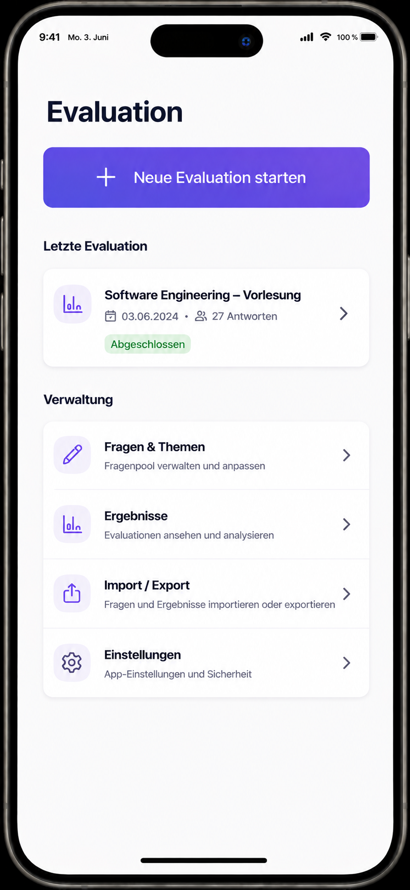
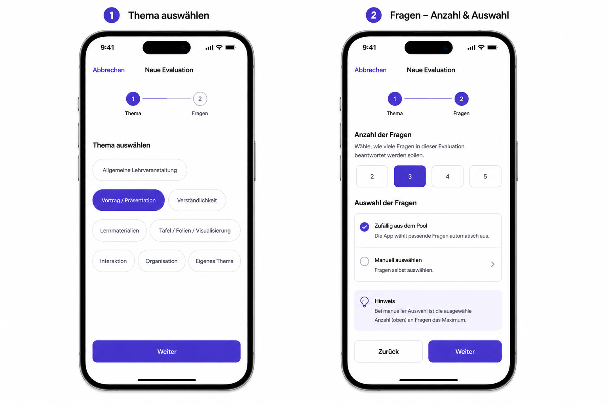
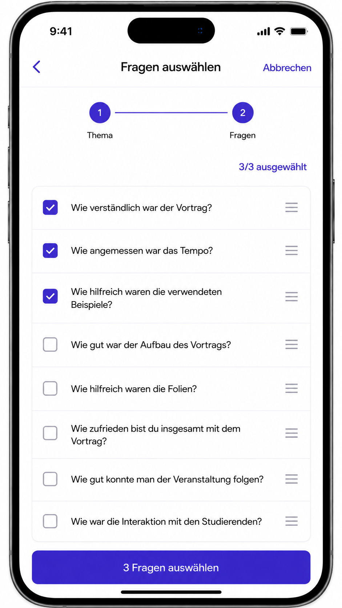
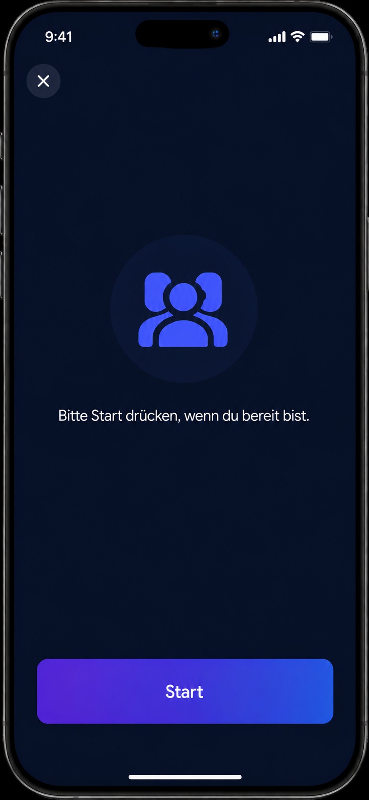
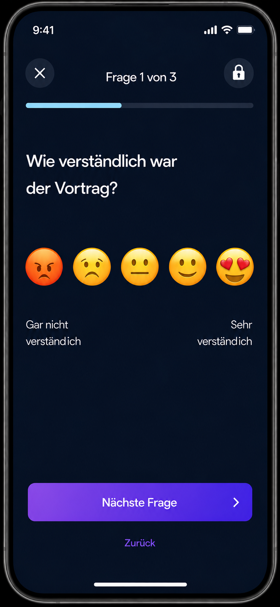
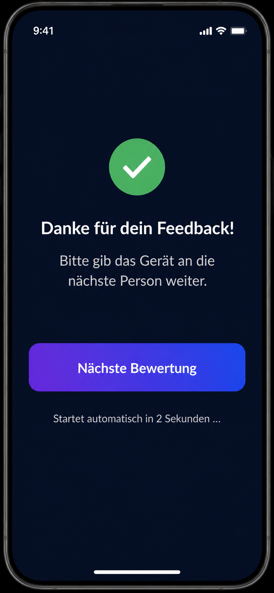
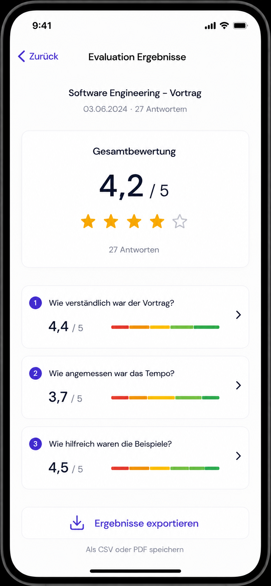

# Lectura

Lectura is a simple app for evaluating lectures in university

## Dependencies

````shell
dart pub add dart pub add shared_preferences flutter_launcher_icons
````

````shell
dart pub get
````

## Mockup (Pretotype)

| Landing Page                       | Create new Evaluation                         | Question Selection                             | Start Evaluation                             | Evaluation Page                                 | End Evaluation                                | Evaluation Diagrams                             |
|------------------------------------|-----------------------------------------------|------------------------------------------------|----------------------------------------------|-------------------------------------------------|-----------------------------------------------|-------------------------------------------------|
|  |  |  |  |  |  |   |

> Mockup created with OpenAI ChatGPT 5

````text
Erstelle mir ein Mockup für...
````