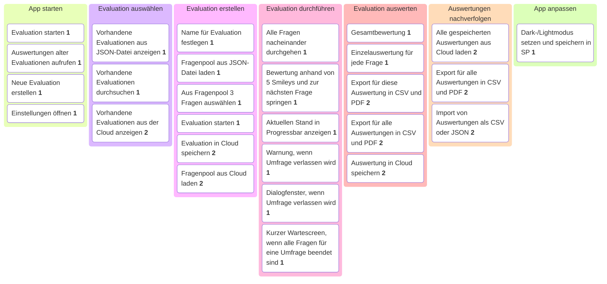

# Lectura 📖

Lectura ist eine einfache App zum Auswerten von Vorlesungen

## Abhängigkeiten

````shell
flutter pub add shared_preferences flutter_launcher_icons flutter_soloud uuid intl flutter_rating
````

## Mockup

Die Mockupversionen können in [Mockup DrawIO](./Process.drawio) nachverfolgt werden

## KI

Zur Erstellung der Mockups und vereinzelten Code passagen wurde generative KI benutzt.
Die genaue Nutzung, inklusive der genutzten Prompts kann in der [KI-History](AI.md) nachverfolgt werden.

## Storyboard

MVP Version: **1**

